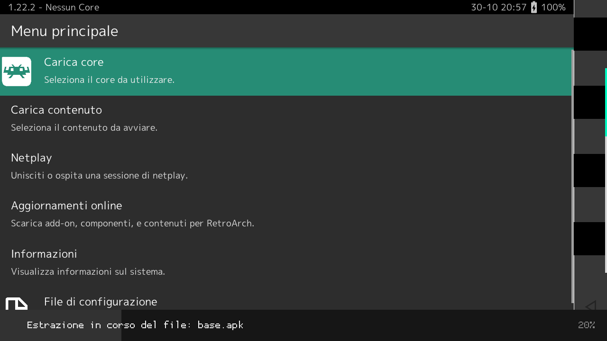
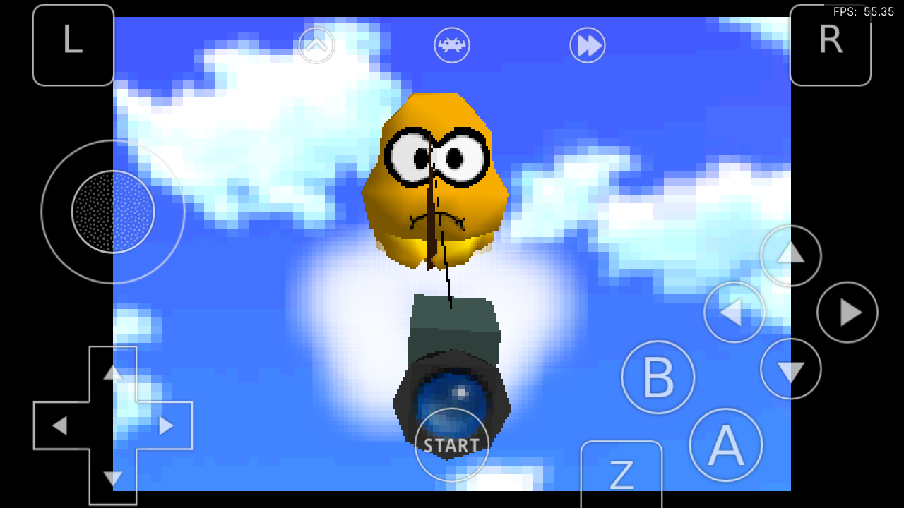
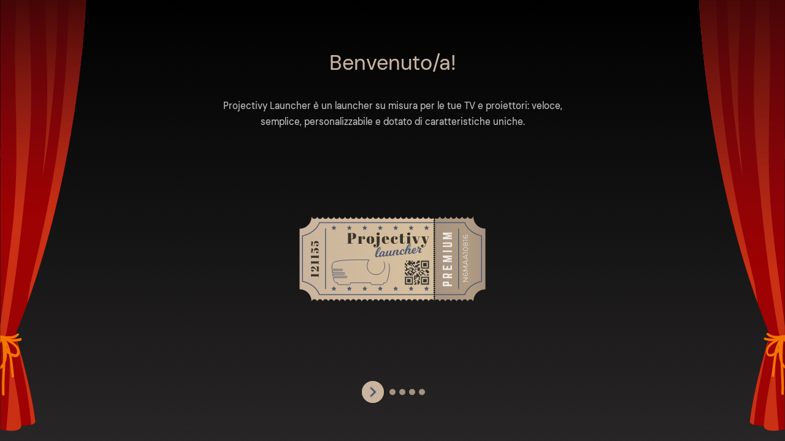

# Reclaiming an "MXQ PRO" TV box (Rockchip RK3229)

Reverse engineering and repurposing of a cheap Chinese Android TV box sold as
"MXQ PRO". From a box sitting in a drawer to: identifying the real hardware,
analyzing the stock ROM (which ships a preinstalled adware backdoor), debloating it,
using it as a retro console with a custom gamepad driver, and finally replacing
Android with Linux (Armbian/Ubuntu) on the eMMC.

> Written for anyone doing the same on an RK3228/RK3229 box. Adapt every command to
> your device. **At your own risk**: you can make the box temporarily unbootable
> (recoverable — see the backup section).

<p align="center">
  
  
  
</p>

---

## 1. What the box really is

"MXQ PRO" is just a marketing name reused by dozens of vendors. The real hardware,
read over ADB:

| Item | Value |
|---|---|
| SoC | **Rockchip RK3229** (4× ARM Cortex-A7, 32-bit, `armeabi-v7a`) |
| GPU | Mali-400 MP2 (OpenGL ES 2.0 only) |
| RAM | 1 GB |
| Storage | 8 GB eMMC (`/dev/block/mmcblk0`, 7634944 KB) |
| Wi-Fi | SSV6051 (`ssv6xxx`) — usually no monitor mode/injection |
| Front display | `FD628_Demo` driver |
| Stock OS | Android 6.0.1 `userdebug`, **test-keys**, build `MV3.20170626` (2017) |
| Kernel | Linux 3.10 (Rockchip vendor) |
| SELinux | **permissive** |
| Root | setuid `su` already in `/system/xbin` + "Superuser" app |

Verify it (the labels routinely lie about RAM/Android/"4K"):

```sh
getprop | grep -E 'ro.board.platform|ro.product.(model|device)|ro.build.version|ro.rk.(cpu|soc)'
cat /proc/cpuinfo        # Hardware : Rockchip RK3229
cat /proc/meminfo        # real MemTotal
```

---

## 2. Access: enabling ADB over the network

These boxes have no "Wireless debugging" (that's Android 11+). With the preinstalled
root you enable ADB over TCP by hand. From a terminal emulator on the box (e.g.
*Terminal Emulator for Android* by jackpal, `jackpal.androidterm`; **not** Termux,
which needs Android 7+):

```sh
su
setprop persist.adb.tcp.port 5555   # persists across reboots
setprop service.adb.tcp.port 5555
stop adbd; start adbd
```

From the PC: `adb connect <box-ip>:5555` and accept the RSA prompt on the TV. Don't
confuse the box with other network-ADB devices (e.g. a smart TV): `adb devices -l`
shows `model:` and `device:`.

Notes (Windows + Git Bash): use `MSYS_NO_PATHCONV=1` and `C:/…` paths for `adb push`,
otherwise absolute `/data/...` paths get rewritten.

---

## 3. ROM analysis: the Adups FOTA backdoor

The most interesting finding. The ROM ships **Adups FOTA** (`com.adups.fota` +
`com.adups.fota.sysoper`, the latter running as UID `system`): an "update service"
that is really a silent app-installation platform.

Decompiling `FotaUpdate.apk` (JADX) shows (`com/adups/fota/a/b.java`) that the URLs are
built character-by-character so they don't show up among the strings:

```
https://fota5.adups.com   (and .cn)
/otainter-5.0/fota5/apkDownlod.do  apkUpgrade.do  apkGroup.do  submitReport.do ...
```

Behavior confirmed in the code:

- Downloads APKs chosen by the server and **installs them silently** with `pm install -r`
  (`com/adups/fota/update/download/g.java` → `Command.with(context).sysRun("pm install -r " + path)`).
  The `AdditionalModel` model has `advUserId`, `advertiseName`, `advApkId` fields:
  these are **advertiser APKs**.
- Runs arbitrary commands with `system` privileges (`Command.sysRun`, bound to
  `com.adups.fota.sysoper`).
- **Disables Google's app verification**: `settings put global package_verifier_enable 0`.
- Sends **IMEI and MAC** to the server (`ro.fota.id=mac`), firmware versions and install
  results; has receivers on `PACKAGE_ADDED/REMOVED/REPLACED` and `BOOT_COMPLETED`.

This family (Adups/FOTA) is known for mass data-collection incidents on cheap devices.
Here it is active out of the box.

### Reproduce the analysis

```sh
adb pull /system/app/FotaUpdate/FotaUpdate.apk
jadx -d out_fota FotaUpdate.apk
grep -rnE "adups|pm install|package_verifier|getDeviceId|sysRun" out_fota/sources
```

---

## 4. Debloating

Reversible: anything `pm disable` is undone with `pm enable`.

```sh
su
for p in com.adups.fota com.adups.fota.sysoper android.rockchip.update.service \
         com.rockchip.devicetest com.ftest com.cghs.stresstest; do
  am force-stop $p; pm disable $p
done
settings put global package_verifier_enable 1          # re-enable app verification
mount -o remount,rw /system
printf '0.0.0.0 fota5.adups.com\n0.0.0.0 fota5.adups.cn\n0.0.0.0 adups.com\n' >> /system/etc/hosts
```

Some "persistent" apps (e.g. `StressTest`) restart even when disabled: remove them from
`/system/priv-app/…` (keep a copy).

---

## 5. As a retro console

### 5.1 32-bit RetroArch

The SoC is 32-bit: you need the **`RetroArch_ra32.apk`** build (not aarch64) from
`buildbot.libretro.com/stable/<ver>/android/`.

Expected performance (≈ Raspberry Pi 2/3): smooth up to NES/SNES/GBA/Mega Drive/PS1 and
older arcade. **N64/PSP/DC/Saturn** no. Super Mario 64 with Mupen64Plus-Next (low-end
settings, **non**-threaded renderer) runs ~50 fps — and that's the ceiling.

Modern armv7 cores may require Android 7+ (`LIBC_N` symbols): on Android 6 some cores
won't load (`dlopen ... __aeabi_memclr4`). If a core `SIGSEGV`s on video startup it's
the legacy Mali-400 driver: lower/disable the core's GPU options.

### 5.2 Custom driver for Xbox One / GIP pads (NACON Pro Compact)

The 3.10 kernel **has no** `xpad` for GIP pads (Xbox One, the NACON included): the pad
half-powers on, the LEDs stay off, Android doesn't see it as a gamepad. Fix: a
userspace driver ([`gipd/gipd.c`](gipd/gipd.c)) that:

1. claims the USB interface via `usbdevfs` (needs root);
2. sends the GIP init sequence (power-on, LED on, … the same packets as the mainline
   `xpad` driver). **Only after this do the pad's LEDs/logo turn on**;
3. re-exposes the pad through `uinput` as an Xbox 360 (`045e:028e`), so Android uses its
   stock keylayout.

Build (cross, no NDK, with [Zig](https://ziglang.org)): [`gipd/build.sh`](gipd/build.sh).
Autostart: added to `/system/bin/preinstall.sh` (init, every boot as root).

---

## 6. Full backup (ALWAYS, before touching partitions)

Partitions (`by-name`): `uboot, trust, misc, baseparamer, resource, kernel, boot,
recovery, backup, metadata, kpanic, system, userdata`. Dump everything except
`userdata` (fast onto a USB stick in the box):

```sh
su
B=/dev/block/platform/30020000.rksdmmc/by-name
O=/mnt/media_rw/<usb-uuid>/backup; mkdir -p $O
for p in uboot trust misc baseparamer resource kernel boot recovery backup metadata kpanic system; do
  dd if=$B/$p of=$O/$p.img bs=1M
done
cd $O && md5sum *.img > md5.txt
```

Cross-check: `md5sum` of the file == `md5sum` of the partition on the device.

---

## 7. Replacing Android with Linux (Armbian) on eMMC

### 7.1 Key constraints

- **Official "Ubuntu Server" will NOT run**: it's arm64 only, the box is armv7
  (32-bit). The real equivalent is **Armbian for `rk322x-box`** (32-bit Ubuntu/Debian
  userland), from `armbian.com/boards/rk322x-box` ("current" images = mainline kernel).
- **Mainline may fail to boot from SD** on some board revisions (black screen, no
  network). The **legacy** images (4.4 vendor kernel) would be more compatible, but
  **the historical hosts are dead** (users.armbian.com/jock, imola, hosthatch): poor
  availability.
- These boxes **boot from microSD before eMMC**.

### 7.2 The Multitool

A legacy service environment (by Paolo Sabatino / "jock") that boots reliably on these
boxes **and shows a menu over HDMI**. The supported way to backup/restore/write the
eMMC. Source: `github.com/paolosabatino/multitool` (build it yourself); author's
prebuilt image: `https://apt.undo.it:7243/multitool-rk322x.xz`.
Menu: `backup flash`, `restore flash`, `erase flash`, `burn image to flash`,
`drop to bash shell`, `reboot`, `shutdown`.

### 7.3 Writing an image to microSD (Windows, no extra software)

Decompress `.img.xz` with Python (`lzma`) and write to the SD's physical drive.
**Dangerous: the wrong disk wipes other data.** Script with safety checks (USB bus
type, 2–128 GB, not boot/system): [`scripts/flash_sd.ps1`](scripts/flash_sd.ps1). Key
Windows gotcha: removable media can't be set offline; disable automount with `diskpart`
(`automount disable` + `clean`) **before** writing, or Windows re-mounts the partition
mid-write → "Access denied".

### 7.4 Flashing eMMC with a minimal Multitool (no wget/curl)

This Multitool had a **read-only squashfs rootfs** and **no** `wget`, `curl`,
`busybox`, `telnetd`; `passwd`/`chpasswd` fail ("authentication token manipulation
error", `/etc/shadow` not writable) → no classic SSH.

Trick: the shell is **bash**, which opens TCP sockets via `/dev/tcp`. No download tool
needed — stream the raw image from the PC straight onto the eMMC device. On the PC, a
raw TCP server ([`scripts/rawserve.py`](scripts/rawserve.py)) sends the bytes of the
**already-decompressed** file:

```sh
python rawserve.py 9000 Armbian_rk322x_resolute_minimal.img     # on this PC (LAN)
```

On the box (Multitool bash), find the devices with `cat /proc/partitions`:
- `mmcblk2` (with `mmcblk2boot0/boot1/rpmb`) = **internal eMMC** → target;
- `mmcblk0` = the microSD.

Then, one line, no pipes:

```sh
cat < /dev/tcp/<pc-ip>/9000 > /dev/mmcblk2
sync
```

Then `poweroff`, **remove the microSD**, power on → boots from eMMC. The Armbian image
is a full disk image (idbloader + u-boot + boot + root), so writing it to the whole
`mmcblk2` installs the bootloader too. First boot resizes the rootfs.

### 7.5 Headless access

If it comes up with Ethernet (cable + DHCP), log in over SSH. Find the box by its MAC
in the ARP table and port 22 open. If it never appears on the network and the screen
stays black → mainline lacks drivers for this board: fall back to `restore flash`
(Android), or run a Debian/Ubuntu chroot **on top of** Android (always works; cost: RAM).

### 7.6 Outcome on this unit

The very same mainline image (Armbian "resolute", kernel 6.18) that **showed no video
and no network from SD** booted fine when written to the **eMMC** (bootloader included):
U-Boot on screen, HDMI login, working Ethernet, Internet OK. Two details:

- the network interface is not `eth0` but **`end0`** (predictable naming on recent
  kernels): look for the box by IP/port 22, not by `eth0`;
- the SSV Wi-Fi (`wlan0`) stays `DOWN` on mainline — use the cable.

Takeaway: for these boxes **don't stop at a failed SD boot**, try writing to eMMC
anyway. Final headless access via SSH key (the Armbian rootfs is writable, so install
`authorized_keys` with a `wget` from the console).

Result: a drawer box → a headless Linux mini-server (4 cores, ~970 MB RAM, ~5.8 GB free,
~2–3 W). Sensible uses: Pi-hole/AdGuard, WireGuard, Syncthing, small services.

---

## 8. Repo contents

```
.
├─ README.md                this document
├─ gipd/
│  ├─ gipd.c                userspace Xbox One/GIP pad driver → uinput 360
│  └─ build.sh              cross build with Zig
├─ scripts/
│  ├─ flash_sd.ps1          write an image to SD (Windows, with safety checks)
│  └─ rawserve.py           raw TCP file streamer to flash a box via bash /dev/tcp
└─ docs/img/                screenshots
```

Not included (large or proprietary): Armbian/Multitool images, system APKs, decompiled
sources, partition dumps.

## 9. Tools & credits

- Reverse engineering guided with **REA — reverse-engineer-anything**
  (`github.com/morluto/rea`): device inventory over ADB and the Android provider
  (jadx-headless-mcp) for decompilation.
- **JADX** for APK decompilation; **Zig** to cross-compile the driver; **Armbian**
  (`rk322x-box`) and Paolo Sabatino's **Multitool** for the move to Linux.

## 10. Quick lessons

- The marketing name tells you nothing: identify the SoC from `/proc/cpuinfo`.
- Distrust these stock ROMs: this one shipped Adups, installing apps silently and
  disabling the security checks.
- 1 GB RAM + Mali-400 GLES2 = retro up to PS1, no further; a media center and a small
  Linux server are the most sensible uses.
- The rk322x ecosystem has decayed: the Multitool is the reliable entry point, and
  bash `/dev/tcp` saves you when download tools are missing.
- **Always** back up fully first: the box is nearly impossible to permanently brick
  (BootROM + USB maskrom), but recovering without a backup is tedious.
